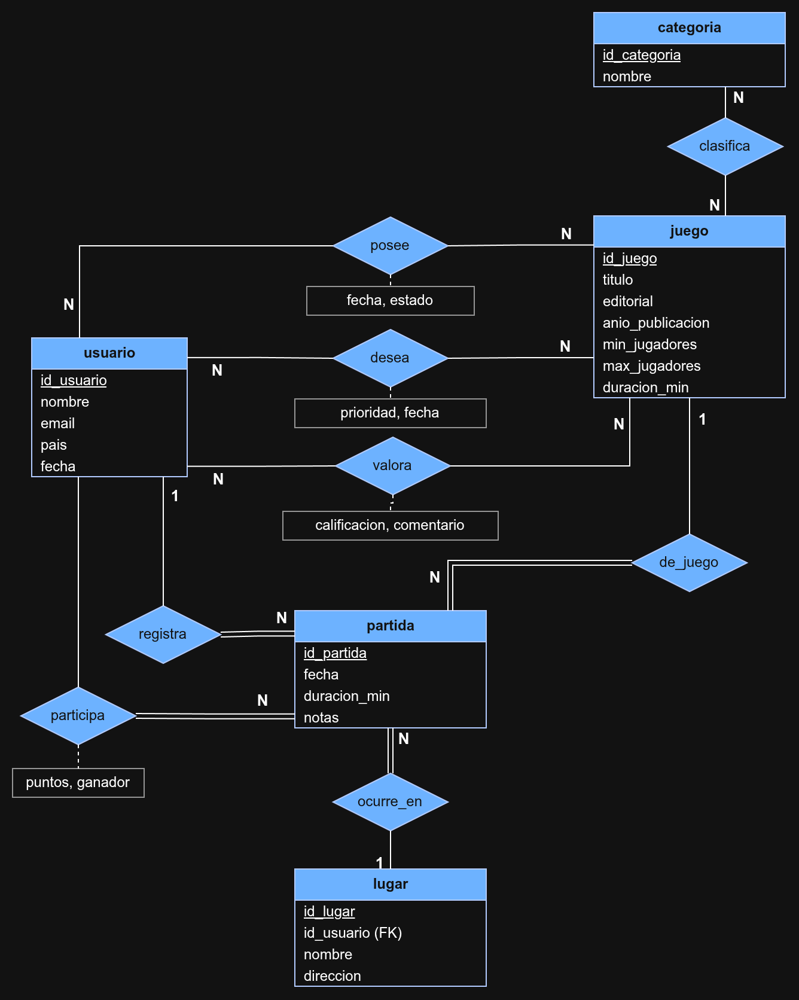

<div align="center">

<h1>MiBDJ</h1>
<p>Mi base de datos de juegos de mesa</p>
<p><strong>Backend · Java 21 · Spring Boot · MySQL</strong></p>

[Configurar el proyecto](docs/setup.md) · [Consultar la API](docs/api.md) · [Ver el frontend](https://github.com/rgdan/mibdj-frontend)

</div>

---

Un catálogo de juegos de mesa con colección personal, lista de deseos y
valoraciones. Registrá tus partidas, los participantes, sus puntos y ganadores;
consultá el historial y las estadísticas de juego de cada usuario.

[Inicio local](#inicio-local) · [Funcionalidades](#funcionalidades) · [Estructura](#estructura) · [Base de datos](#base-de-datos)

## Inicio local

Necesitás JDK 21 y Docker en ejecución. El repositorio incluye Maven Wrapper;
la primera ejecución descarga Maven y sus dependencias.

1. Seguí la [guía de configuración](docs/setup.md#mysql-con-docker) para crear
   MySQL 8.4 e importar el esquema y los datos iniciales.
2. Desde la raíz del backend, creá el archivo de configuración:

   ```sh
   cp .env.example .env
   ```

   Completá `DB_URL`, `DB_USR_NAME` y `DB_PWD` con la conexión a tu contenedor.
   La guía incluye [valores de ejemplo para desarrollo local](docs/setup.md#3-configurar-la-conexión).

3. Con MySQL listo, arrancá el backend:

   ```sh
   ./mvnw spring-boot:run
   ```

4. Comprobá el servicio y su conexión a la base:

   ```sh
   curl http://localhost:8080/actuator/health
   ```

   Debe responder `200 OK` con `"status":"UP"`. La API queda en
   `http://localhost:8080`.

Para compilar sin arrancar la aplicación ni necesitar MySQL:

```sh
./mvnw clean compile
```

## Funcionalidades

| Área | Qué podés hacer | Referencia |
|---|---|---|
| Usuarios | Entrar con el email de un usuario precargado y consultar su perfil. | [Acceso por email](docs/api.md#acceso-por-email) |
| Catálogo | Buscar juegos por título, filtrar por categoría y consultar sus detalles. | [Juegos](docs/api.md#juegos) |
| Colección | Agregar juegos propios, guardar fecha y estado, actualizar o quitar elementos. | [Colección personal](docs/api.md#colección-personal) |
| Wishlist | Guardar juegos deseados con fecha y prioridad. | [Lista de deseos](docs/api.md#lista-de-deseos) |
| Valoraciones | Guardar una nota y un comentario; consultar valoraciones y promedios. | [Valoraciones](docs/api.md#valoraciones) |
| Partidas | Elegir un lugar del usuario, registrar participantes y consultar historial y detalle. | [Partidas](docs/api.md#partidas) |
| Estadísticas | Consultar juegos más jugados, duración promedio y compañeros frecuentes. | [Estadísticas](docs/api.md#estadísticas-de-usuario) |

El acceso es un pseudologin por email: usa usuarios precargados, sin contraseña
ni tokens. Las rutas reciben el ID de usuario y no requieren autenticación.

## Estructura

Las solicitudes pasan por controladores REST, servicios y repositorios.
Los repositorios ejecutan SQL parametrizado con `JdbcTemplate` contra MySQL.

```text
src/main/
├── java/teccr/mibdj/
│   ├── api/          Controladores y cuerpos de entrada
│   ├── service/      Validaciones y transacciones
│   ├── repository/   Consultas SQL con JdbcTemplate
│   └── data/         Objetos de respuesta
└── resources/
    ├── application.properties
    ├── schema.sql    Tablas, restricciones y vista
    └── data.sql      Datos iniciales
```

## Base de datos

`juegos_mesadb` contiene 10 tablas y la vista `vw_partidas_usuario`, usada en
el historial. El seed incluye 5 usuarios y 8 juegos de mesa.

[Esquema SQL](src/main/resources/schema.sql) · [Datos iniciales](src/main/resources/data.sql) · [Diagrama editable](docs/diagrama-bd.drawio)

<details>
<summary>Ver el diagrama de la base de datos</summary>



</details>

Las instrucciones de [MySQL con Docker](docs/setup.md#mysql-con-docker)
explican la importación inicial y cómo conservar los datos entre reinicios.
Los contratos, ejemplos y límites actuales están en la [referencia de la API](docs/api.md).
